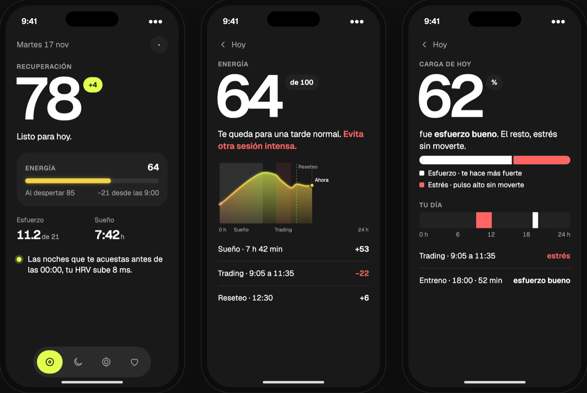
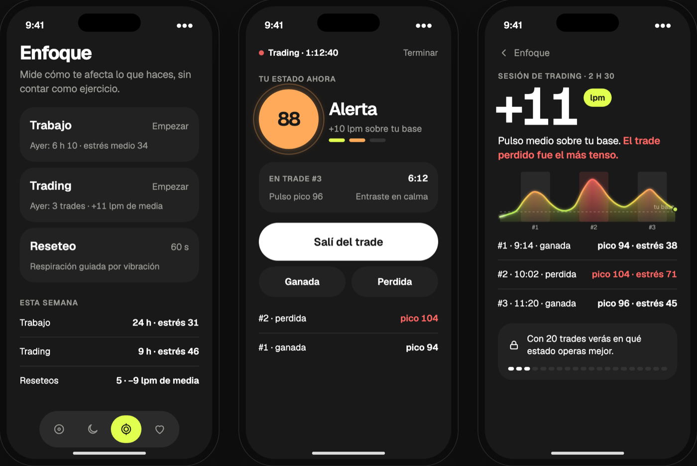
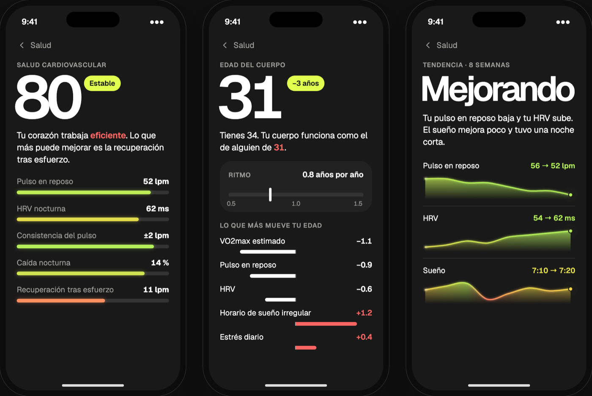
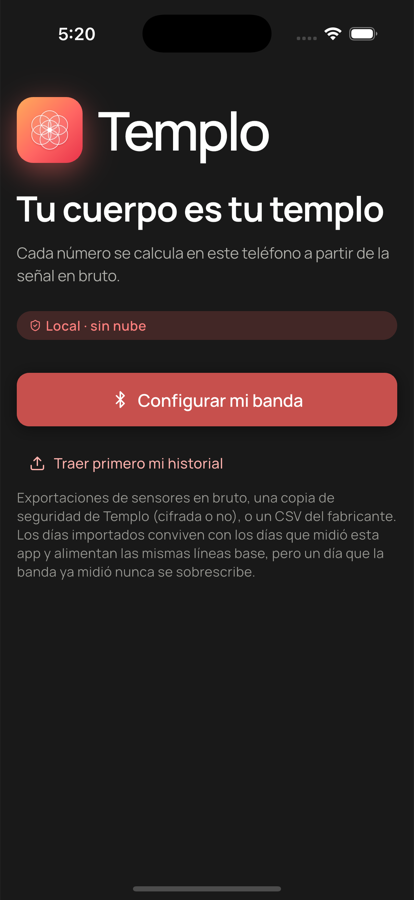
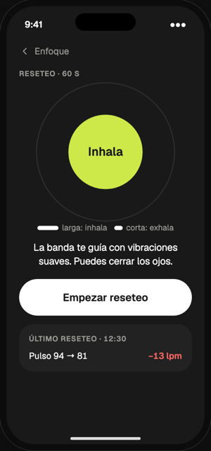

<p align="center">
  
</p>

<h1 align="center">Templo</h1>

<p align="center"><b>Tu cuerpo es tu templo.</b><br>
Usa tu WHOOP 4.0 sin pagar la membresía, con todo calculado en tu iPhone y funciones que no tienen ni la app de WHOOP ni la de OpenStrap.</p>

<p align="center">
  
  
  
  
  
</p>

<p align="center">
  <a href="#-qué-es">Qué es</a> ·
  <a href="#-qué-tiene-de-nuevo">Novedades</a> ·
  <a href="#-instalarla">Instalarla</a> ·
  <a href="#-hazla-tú-con-una-ia">Hazla tú con una IA</a> ·
  <a href="#-de-dónde-viene">De dónde viene</a> ·
  <a href="#-english">English</a>
</p>

<p align="center"></p>

---

## ✦ Qué es

Tenía una WHOOP 4.0 en un cajón porque no quería pagar la membresía. Templo la vuelve a hacer útil:

- **Sin suscripción y sin cuenta.** La app habla con la banda por Bluetooth, como la app oficial.
- **Tus datos se quedan en tu teléfono.** Todo se calcula en el iPhone. No hay nube, no hay estadísticas, no hay rastreo.
- **Hecha a medida.** Además de lo que ya traía OpenStrap (recuperación, sueño, HRV, esfuerzo, entrenamientos), tiene funciones nuevas pensadas para el día a día y para quien hace trading.

> [!WARNING]
> **No vuelvas a conectar la banda a la app oficial de WHOOP.** Puede actualizarle el firmware y bloquear el acceso a los datos. Desvincúlala y desinstala la app de WHOOP antes de emparejarla con Templo.

## ✦ Qué tiene de nuevo

<table>
<tr><td width="50%" valign="top">

**Energía**
Una barra de 0 a 100 que empieza con tu recuperación al despertar, baja con el estrés y el esfuerzo y sube un poco cuando estás en calma. Ves qué la movió durante el día.

**Esfuerzo bueno frente a estrés**
Pulso alto mientras te mueves es esfuerzo; pulso alto estando quieto es estrés. Ves qué parte de tu carga del día fue cada cosa.

**Consejo del día**
Una sola frase en Hoy, sacada de tus propios números.

</td><td width="50%" valign="top">

**Enfoque: Trabajo y Trading**
Sesiones que no cuentan como ejercicio. En trading marcas cada entrada y salida y si fue ganada o perdida. Un semáforo te dice si estás en calma, alerta o acelerado según tu pulso. Con 20 trades verás en qué estado operas mejor.

**Reseteo**
60 segundos de respiración 4-6 guiada por la vibración de la banda. Lo empiezas tú; la banda nunca vibra sola.

</td></tr>
<tr><td valign="top">

**Salud cardiovascular**
Un puntaje de 0 a 100 inspirado en Hume con cinco medidas de la banda: pulso en reposo, HRV, consistencia del pulso, caída nocturna y recuperación tras esfuerzo.

**Tendencia de 8 semanas**
Si vas a mejor o a peor en pulso, HRV y sueño.

</td><td valign="top">

**Edad del cuerpo**
Tu edad según tus hábitos de las últimas 4 semanas y qué te suma o te resta años.

**Diseño nuevo**
Minimalista, con modo día y noche, un número protagonista por pantalla y gráficas con brillo que cambian de color según si el dato es bueno (lima) o malo (rojo).

</td></tr>
</table>

<p align="center"></p>
<p align="center"></p>

<p align="center"><sub>Las imágenes de arriba son los diseños con datos de ejemplo. Abajo, la app real en el simulador.</sub></p>

<p align="center">
  
  &nbsp;&nbsp;
  
</p>

**Honestidad ante todo:** si falta un dato, la app muestra "—" y dice por qué. Nunca rellena con números inventados. Energía y Edad del cuerpo son estimaciones y lo dicen. Nada de esto es un diagnóstico médico.

**Lo que no hace:** no mide oxígeno en sangre. La WHOOP 4.0 no da una lectura fiable de SpO₂ por Bluetooth, así que no se muestra.

## ✦ Instalarla

No está en la App Store. Se compila desde este código en tu Mac y se instala en tu iPhone.

**Necesitas:** un Mac con Xcode, [Flutter **3.41.6**](https://docs.flutter.dev/get-started/install) (esa versión exacta), CocoaPods, una cuenta de Apple (sirve la gratuita) y tu iPhone con cable.

```bash
git clone https://github.com/iamnastynash/templo.git
cd templo
flutter pub get
cp ios/Config/Signing.xcconfig.example ios/Config/Signing.xcconfig
```

Edita `ios/Config/Signing.xcconfig`: pon identificadores únicos (por ejemplo `com.tunombre.templo`) y tu **Team ID** (Xcode → Settings → Accounts).

```bash
flutter devices
flutter run --release -d ID_DE_TU_IPHONE
```

La primera vez, en el iPhone: **Ajustes → General → VPN y gestión de dispositivos → Confiar**. Y activa **Modo desarrollador** en Ajustes → Privacidad y seguridad.

<details>
<summary><b>Problemas frecuentes</b></summary>

- **iPhone con iOS 26:** necesitas Xcode 26, que pide macOS 15.6 o más nuevo.
- **Error con `BGContinuedProcessingTask` al compilar:** usas Xcode 16. La librería `workmanager_apple` usa una API de iOS 26. Actualiza a Xcode 26.
- **Error de capacidades (App Groups, HealthKit) al firmar:** algunas funciones (widgets, Apple Watch, Apple Health) pueden pedir la cuenta de desarrollador de pago.
- **Deja de abrir a los 7 días:** con cuenta gratuita Apple caduca la firma. Vuelve a ejecutar `flutter run`; tus datos se quedan.

</details>

## ✦ Hazla tú con una IA

¿No quieres descargar esta? Copia **[MASTER_PROMPT.md](MASTER_PROMPT.md)** y pégaselo a tu modelo de IA favorito (Claude, ChatGPT, Gemini…) con acceso a tu ordenador. Te guía para crear tu propia versión: eliges el nombre, el icono y los colores, y te construye las mismas funciones paso a paso.

## ✦ De dónde viene

Templo es un fork de **[OpenStrap Edge](https://github.com/OpenStrap/edge)**, la app libre que descifró el Bluetooth de la WHOOP y calcula las métricas en el teléfono. Todo el trabajo de conexión con la banda, la sincronización y los algoritmos base es suyo. Gracias.

Sobre esa base, Templo cambia el diseño, añade las funciones de arriba, quita la marca de OpenStrap (como pide su [política de marca](TRADEMARKS.md)) y corta toda conexión con sus servidores (estadísticas, informes de fallos y subida de datos). Los cambios están en [NOTICE.md](NOTICE.md).

- **No está afiliada** con WHOOP, Inc. ni con el proyecto OpenStrap. "WHOOP" solo se usa para decir con qué banda funciona.
- **Licencia:** [AGPL-3.0](LICENSE), la misma que OpenStrap. Si distribuyes una versión modificada, tienes que compartir su código bajo la misma licencia.
- **No es un dispositivo médico.**

---

## ✦ English

**Templo** turns a WHOOP 4.0 into a subscription-free, fully on-device iPhone app. It is a fork of [OpenStrap Edge](https://github.com/OpenStrap/edge) with a new minimal design (day/night), and adds: an Energy score, good-effort vs stress split, a daily tip, a Hume-inspired cardiovascular score, 8-week trends, body age, and **Focus** sessions for work and trading (trade markers, a heart-rate traffic light, a 20-trade insight) plus a haptic 60-second reset. No telemetry, no cloud, no OpenStrap branding or services. Not affiliated with WHOOP or OpenStrap. AGPL-3.0. Build it from source (see *Instalarla*) or rebuild your own with [MASTER_PROMPT.md](MASTER_PROMPT.md).
