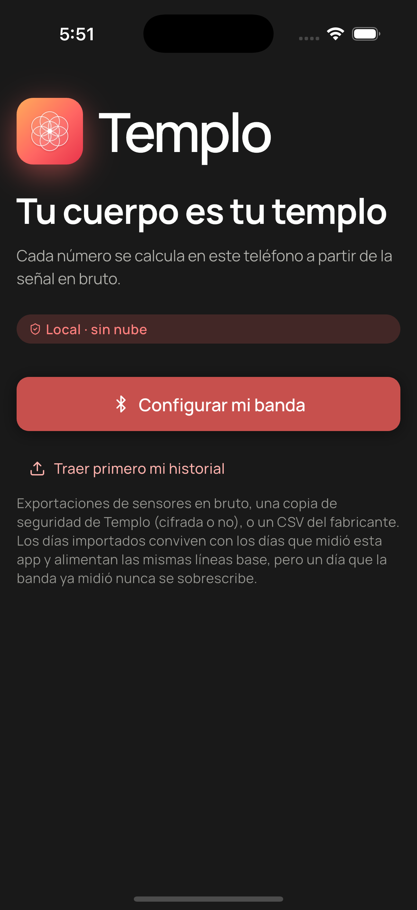
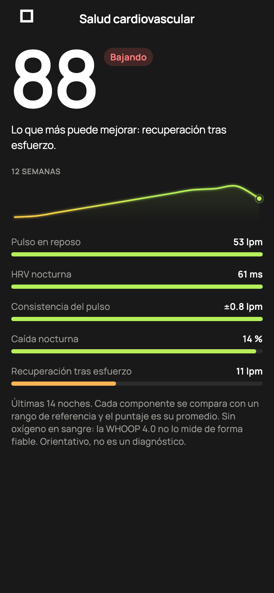
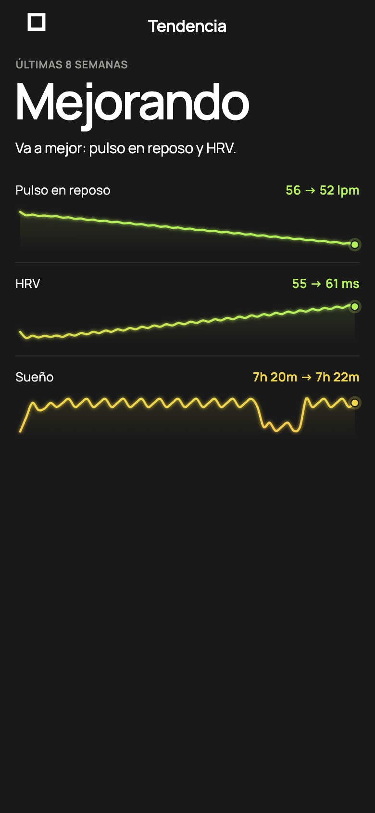

  
  <h1>Templo</h1>
  
<strong>Sueño, recuperación y enfoque con tu pulsera WHOOP compatible.</strong>

  
Una app independiente, de código abierto y sin cuota propia.

  

    <a href="https://github.com/iamnastynash/templo/archive/refs/heads/main.zip">Descargar código</a> ·
    <a href="docs/INSTALACION.md">Instalar</a> ·
    <a href="MASTER_PROMPT.md">Recrear con IA</a> ·
    <a href="CHANGELOG.md">Ver cambios</a>
  

Templo nació para seguir usando una WHOOP compatible sin depender de una membresía y para añadir herramientas que echábamos de menos en WHOOP y OpenStrap. Se conecta por Bluetooth y calcula las métricas principales en el teléfono. La app conserva las funciones locales de OpenStrap Edge y añade una interfaz propia en coral y lima con modo día y noche.

|  |  |  |
| :---: | :---: | :---: |
| Bienvenida · simulador iOS | Salud cardiovascular · demo | Tendencia de ocho semanas · demo |

Las vistas de métricas usan datos de ejemplo.

## Qué añade Templo

- **Hoy.** Recuperación, sueño y esfuerzo de un vistazo, una estimación de energía y un desglose entre actividad y carga en reposo.
- **Enfoque.** Sesiones de trabajo y trading con pulso en vivo cuando hay señal. Marcadores manuales para operaciones y una pausa de respiración guiada.
- **Salud.** Resumen cardiovascular, tendencias de ocho semanas y una estimación de edad corporal según las métricas disponibles. Son indicadores orientativos de bienestar.
- **Identidad visual propia.** Icono de flor de la vida y temas claro y oscuro.

## Compatibilidad

La base contempla WHOOP 4.0, 5.0 y MG. La sincronización depende del firmware. En algunas versiones de WHOOP 5.0 y MG, la pulsera puede conectarse por Bluetooth y aun así retener datos por un requisito de membresía firmado por el fabricante. Consulta el [informe de compatibilidad de OpenStrap](https://github.com/OpenStrap/edge/issues/673) antes de actualizar o cambiar de app. La validación de esta versión en una pulsera física sigue pendiente.

## Instalar o crear tu propia versión

- **Desde código.** Sigue la [guía para iPhone y Android](docs/INSTALACION.md). La descarga contiene el código fuente. En iPhone se instala con Xcode y tu firma de Apple.
- **Desde un prompt.** Copia el [prompt maestro](MASTER_PROMPT.md) en tu asistente de programación. Puedes elegir tu propio nombre, logotipo y colores, o pedirle que conserve **Templo** y la flor de la vida. Si quieres conservar ambos, comparte con el asistente el [PNG del logotipo](assets/images/icon.png).

## Origen y licencia

Templo deriva de [OpenStrap Edge](https://github.com/OpenStrap/edge/tree/cd64eaa8) y conserva su historial. Usa los paquetes [OpenStrap Protocol](https://github.com/OpenStrap/protocol) y [OpenStrap Analytics](https://github.com/OpenStrap/analytics). El código derivado se publica bajo [GNU AGPL v3](LICENSE). Los [avisos](NOTICE.md) y las [marcas del proyecto original](TRADEMARKS.md) se conservan. WHOOP es una marca de su titular. Templo es un proyecto independiente.

## Pruebas

Resultado registrado tras la limpieza de OpenStrap · **9.643 aprobadas y 3 fallos preexistentes**. Los fallos corresponden a la importación de una copia de seguridad y a dos comparaciones de métricas de WHOOP 4.0 y 5.0. Las 32 pruebas específicas de cálculo y pantallas de Templo pasan. Ejecuta la suite con `flutter test`.
